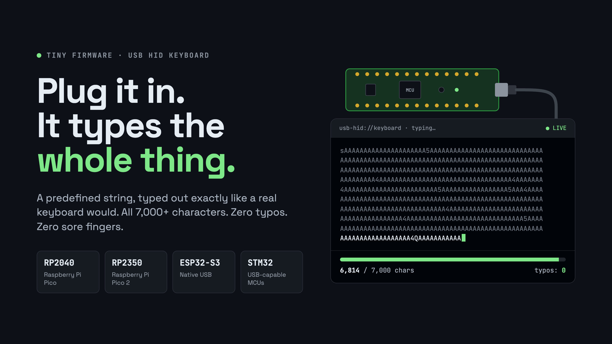

# pico-keystroker

Barebones USB HID keystroker. Plug it in, it enumerates as a USB keyboard
named `HID_KEYBOARD_NAME`, and it types the contents of `config/input.txt`
once per trigger — either automatically after a countdown, or when you press
a button. No QMK, no frameworks on the firmware path: a thin per-board HAL
plus a shared, host-testable C99 core.

## How it works

1. `tools/embed.py` bakes `config/input.txt` (the payload) and
   `config/config.ini` (the settings) into `generated/payload.h` as C byte
   arrays — the firmware has no filesystem.
2. On boot the firmware loads the embedded config (`config_set_defaults` +
   `config_parse_string` + `config_validate`; compiled-in defaults win on
   any failure).
3. The super-loop waits for the trigger, then `typing_engine.c` converts
   the payload to HID press/release actions (`hid_keymap.c` per `LANGUAGE`;
   `\n`/`\r` become ENTER, `\t` becomes TAB, unmapped bytes are skipped and
   counted) and pushes each action via `hal_hid_send()` with
   `TYPING_DELAY_MS` between actions.

## Repo layout

```
src/common/        shared core: config_parser, hid_keymap, typing_engine,
                   button (host-testable C99, no MCU headers, no malloc)
targets/rp2040/         Pico (RP2040): main.c, hal_port.c, board_config.h,
                        usb_descriptors.*, tusb_config.h, CMakeLists.txt
targets/rp2040-zero/    RP2040-Zero board header (WS2812 on GPIO16, no LED)
targets/rp2350/         Pico 2 (RP2350): same layout as rp2040
targets/stm32f401-mini/ STM32 Mini F401: main.c, hal_port.c,
                        board_config.h, platformio.ini
targets/blackpill/      WeAct Black Pill: same layout as stm32f401-mini
targets/esp32c3/        console-only STUB (no USB-HID possible, see below)
targets/esp32s3/        ESP32-S3 (Zero / DevKitC-1): USB-OTG HID keyboard
                        (main.cpp, hal_port.cpp, board_config.h, platformio.ini)
targets/README.md       port matrix, pinout notes, "add a new board"
config/config.ini       settings (WRITE_MODE, COUNTDOWN_MS, ...)
config/input.txt        payload: typed verbatim, plain ASCII
tools/embed.py          payload/config -> generated/payload.h
tests/                  host unit tests (minunit): 4 suites
cmake/                  ARM toolchain file
.github/workflows/      ci.yml (make test + coverage), release.yml (below)
CMakeLists.txt          Pico firmware build (Pico SDK + picotool -> .uf2)
Makefile                host core: test / coverage / embed / clean
```

## Configuration (`config/config.ini`)

Keys are case-insensitive; `#`/`;` start comments, `[section]` lines are
skipped, unknown keys are ignored. `WRITE_MODE` is required.

| Key | Values | Notes |
|---|---|---|
| `WRITE_MODE` | `button` \| `time` | **Required.** Button waits for a press; time auto-types after mount + countdown. |
| `COUNTDOWN_MS` | 1..3600000 | Required in `time` mode, ignored in `button` mode. Counts from USB mount (enumeration), not from power-on. |
| `HID_KEYBOARD_NAME` | string | USB product string, default `Arboard-2040-pico-keystroker`. Fixed at enumeration (compile) time — the runtime value is parsed but cannot rename an already-enumerated device. |
| `LANGUAGE` | `en_US` \| `tr_TR` \| `de_DE` \| `fr_FR` | Default `en_US`. **The host OS layout must match**, or shifted/symbol keys come out wrong. |
| `BUTTON_PIN` | 0..29 | GPIO of the trigger button (RP2040 numbering). |
| `TYPING_DELAY_MS` | 0..60000, default 8 | Delay between HID actions while typing. |
| `DOUBLE_CLICK_MS` | 0..60000, default 400 | Second press inside this window is dropped (see below). |
| `DEBOUNCE_MS` | 0..60000, default 30 | Raw level must be stable this long to count. |

Payload (`config/input.txt`): typed **verbatim as-is** — there is no comment
syntax, every byte (including any `#` line) is typed. Keep to plain ASCII;
`config/input.txt` ships with a symbols line that exercises the en_US map.
Non-ASCII/UTF-8 bytes have no HID mapping and are silently skipped.

## Button wiring

- **Pico / Pico 2:** external button on **GP15 → GND** (internal pull-up,
  active-low). Default `BUTTON_PIN = 15`.
- **RP2040-Zero:** same button default (GPIO15); status LED is a **WS2812
  on GPIO16** (no discrete LED — firmware builds pass
  `-DKEYSTROKER_LED_PIN=-1`), otherwise identical RP2040 silicon/flash/USB.
- **STM32 Mini F401 / Black Pill:** external button on **PA0 → GND**
  (internal pull-up, active-low); user LED on PC13 (sink: LOW = on). USB
  device on PA11/PA12. There is no usable on-board button (BOOT0 is
  boot-strapping, NRST is reset). **+5V pins tie directly to USB +5V —
  never power from USB and an external supply at the same time.**
- **ESP32-S3 (Zero / DevKitC-1):** press the board's **BOOT button on
  GPIO0** (internal pull-up, active-low — no wiring). Optional external
  button to GND on GPIO4. No status LED (onboard WS2812 unused).
- **BOOTSEL stays for flashing** on Pi boards (hold BOOTSEL, plug in, drop
  the `.uf2` onto the mass-storage volume). It is not a trigger input.

Double-click behavior: a debounced rising edge types once; a second rising
edge within `DOUBLE_CLICK_MS` yields `BUTTON_EVENT_DROPPED` and is ignored,
so double clicks collapse to a single typing.

## Build

After editing `config/`, regenerate the embedded payload:

```sh
python3 tools/embed.py --input config/input.txt \
    --config config/config.ini --output generated/payload.h
# or: make embed
```

Host core (no SDK needed):

```sh
make test       # 4 suites (config_parser, hid_keymap, typing_engine, button)
                # + validate (target-contract checks + S3 host contract test)
make coverage   # same + enforce >=90% line coverage on src/common
make validate   # target-contract checks only (tools/validate_targets.py)
```

Firmware builds per target — full prerequisites, build, and flash
step-by-step live in [INSTALL.md](INSTALL.md):

| Target | Build | Artifact |
|---|---|---|
| Pico (RP2040) | `cmake -S . -B build/pico -DPICO_BOARD=pico -DPICO_PLATFORM=rp2040 && cmake --build build/pico` (also: `make build-pico`) | `*.uf2` |
| RP2040-Zero class | `cmake -S . -B build-zero -DKEYSTROKER_TARGET=rp2040-zero ... && cmake --build build-zero` (shares `targets/rp2040` sources; sets Zero USB PID/product string, `KEYSTROKER_LED_PIN=-1`, `KEYSTROKER_WS2812_PIN=16`) | `*.uf2` |
| Pico 2 (RP2350) | `cmake -S . -B build-pico2 -DKEYSTROKER_TARGET=rp2350 ... && cmake --build build-pico2` (also: `make build-pico2`) | `*.uf2` |
| STM32 Mini F401 | from `targets/stm32f401-mini/` (after `ln -s ../../src/common common`): `pio run -e stm32f401_mini` | `firmware.{bin,hex}` |
| Black Pill (F401CC/F411CE) | from `targets/blackpill/`: `pio run -e blackpill_f401` | `firmware.{bin,hex}` |
| ESP32-S3 Zero / DevKitC-1 | from `targets/esp32s3/`: `pio run -e esp32s3-zero` | `firmware.bin` (+ `bootloader.bin`, `partitions.bin`) |
| ESP32-C3 Super Mini | from `targets/esp32c3/`: `pio run -e super-mini-c3` — console stub only, not a keyboard | `firmware.bin` (console) |

Pi targets build with CMake at the repo root (no symlink needed —
`src/common` is compiled in directly, and `tools/embed.py` runs at
configure time; needs `PICO_SDK_PATH` or `-DPICO_SDK_FETCH_FROM_GIT=ON`).
PlatformIO targets compile `common/*.c` via the `common` symlink (on
Windows, copy the dir instead). Flashing: BOOTSEL drag-drop / `picotool`
(Pi), DFU or ST-Link (STM32), BOOT+RESET then `esptool` via PlatformIO
(S3) — see [INSTALL.md](INSTALL.md).

Gotcha (S3): the build forces `-DARDUINO_USB_MODE=0
-DARDUINO_USB_CDC_ON_BOOT=0` (USB-OTG/TinyUSB device mode). The S3
Arduino default (`=1`, Hardware CDC + JTAG) has no TinyUSB device and
cannot enumerate as HID — `hal_port.cpp` fails the build in that mode
instead of shipping a dead keyboard. Plug the board's native-USB/OTG
port (not a UART-only port) into the host.

## Release process

Every push to `main` rebuilds all firmware and moves the floating
**`latest`** tag + GitHub Release to the new binaries
(`.github/workflows/release.yml`). Download URLs are stable:

```
.../releases/download/latest/keystroker-rp2040.uf2
.../releases/download/latest/keystroker-rp2040-zero.uf2
.../releases/download/latest/keystroker-rp2350.uf2
.../releases/download/latest/keystroker-stm32f401-mini.bin
.../releases/download/latest/keystroker-stm32f401-mini.hex
.../releases/download/latest/keystroker-blackpill-f401cc.bin
.../releases/download/latest/keystroker-blackpill-f401cc.hex
.../releases/download/latest/keystroker-esp32s3-zero.bin
```

## Supported targets

| Board | MCU | USB-HID | Artifact | Flash |
|---|---|---|---|---|
| Raspberry Pi Pico | RP2040 | Yes | `.uf2` | BOOTSEL mass-storage |
| RP2040-Zero class | RP2040 | Yes | `.uf2` | BOOTSEL mass-storage |
| Raspberry Pi Pico 2 | RP2350 | Yes | `.uf2` | BOOTSEL mass-storage |
| STM32 Mini F401 | STM32F401CCU6 | Yes | `.bin`/`.hex`/`.dfu` | DFU via USB or ST-Link |
| WeAct Black Pill V1.2 | STM32F401CCU6 (F411CE²) | Yes | `.bin`/`.hex`/`.dfu` | DFU via USB or ST-Link |
| ESP32-C3 Super Mini | ESP32-C3 | **No — stub** | `firmware.bin` (console) | `esptool` via USB-CDC |
| ESP32-S3 (Zero / DevKitC-1) | ESP32-S3 | Yes | `firmware.bin` (+ `bootloader.bin`, `partitions.bin`) | `esptool` via USB (BOOT+RESET flash) |

UF2 exists only for Pi targets (RP2040/RP2350 ROM bootloader format).
STM32 flashes via its ROM DFU bootloader/SWD; ESP32-C3 has no USB-OTG, so
USB-HID is impossible there — for HID use `targets/esp32s3` (S3 has
USB-OTG) or a BLE-HID fork.

## Testing

`make test` runs the 4 host suites under `tests/` (no hardware) plus
`make validate` (static target-contract checks in
`tools/validate_targets.py` over every `targets/` dir + the S3 host
contract test): currently **4/4 PASS**. `make coverage` enforces **>=90%
line coverage** on `src/common` (currently 100%). CI
(`.github/workflows/ci.yml`) runs both on every PR/push, plus an
ESP32-S3 firmware build. Target `main.c`/`main.cpp` files are never
built on the host.

## Extending

New board = `targets/<name>/` with `hal_port.c` (implement the 6-function
HAL: `hal_init`, `hal_is_mounted`, `hal_hid_ready`,
`hal_hid_send(mod, keycode[6])`, `hal_delay_ms`, `hal_button_read`),
`board_config.h` (LED/button pins, USB notes), `main.c` (copy a sibling
super-loop), and a build file (`platformio.ini` or CMake). Reuse
`src/common` untouched; board differences stay in `board_config.h`. Full
checklist in `targets/README.md`.

## License

MIT — see `LICENSE`.
